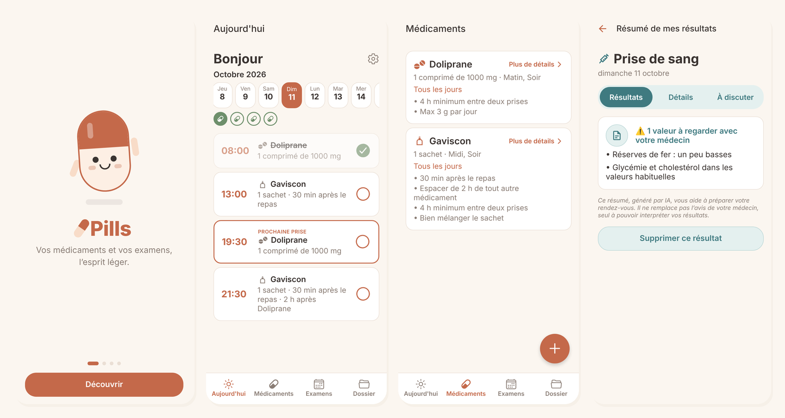
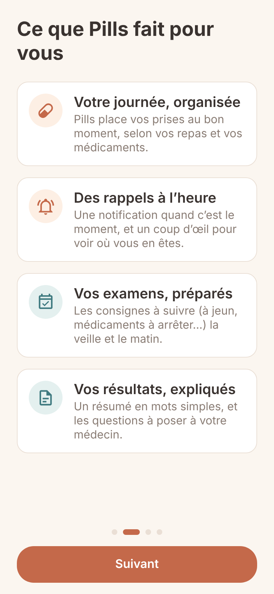
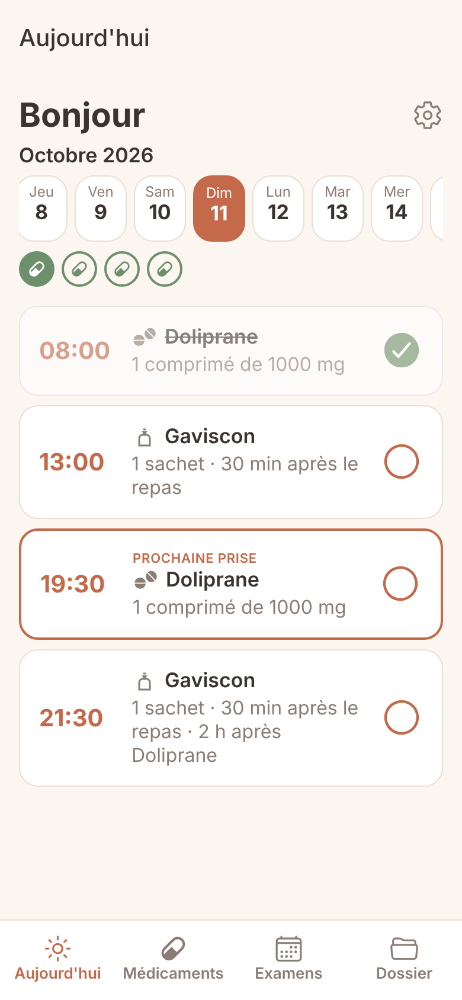
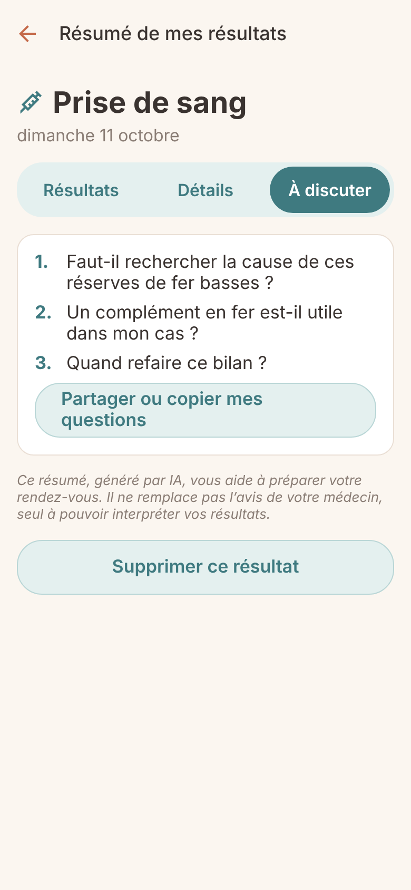

<p align="center">
  
</p>

<h1 align="center">Pills</h1>

<p align="center">
  <b>Vos médicaments et vos examens, l’esprit léger.</b><br/>
  Une app mobile qui organise les prises de médicaments, prépare les examens médicaux et explique les résultats d’analyse en mots simples.
</p>

<p align="center">
  <a href="https://pills-app.expo.app"><b>▶ Essayer la démo web</b></a>
</p>

<p align="center">
  
</p>

> **In English —** Pills is a French-language mobile app (Expo / React Native) that helps people aged 35–65 manage their daily medications and medical exams. It uses the official French drug database (BDPM) and the Claude API to detect each drug's constraints (meals, spacing, intervals), then computes a daily schedule **on the device**, sends reminders, prepares exams from the prescription and summarises lab results in plain language with questions to ask the doctor. Built as a personal portfolio project: MVP shipped in about a week by a product person working with Claude as a coding partner. [Live web demo](https://pills-app.expo.app).

---

## Le problème

Prendre plusieurs médicaments au quotidien demande une vraie charge mentale : à jeun ou pendant le repas, deux heures d’écart avec les autres traitements, quatre heures minimum entre deux prises… Les apps existantes sont des pense-bêtes rigides, au design froid de pharmacie, et laissent la personne déduire seule ces règles. Les examens (prise de sang à jeun, médicaments à arrêter avant) et les résultats d’analyse, illisibles, ajoutent encore de l’inquiétude.

**Cible :** le grand public français de 35 à 65 ans, qui suit 2 à 4 traitements et passe des examens réguliers.

## Ce que fait Pills

| | |
|---|---|
| 💊 **Médicaments** | Recherche dans la base officielle des médicaments (BDPM, 8 500 références). L’IA détecte les contraintes de prise (repas, espacements, délai de sécurité) et les explique simplement, avec le « pourquoi ». |
| 🗓️ **Planning du jour** | Calculé sur le téléphone, sans IA : les prises sont placées selon vos horaires de repas et les contraintes de chaque médicament. On peut déplacer une prise : seules les suivantes sont recalculées, avec un avertissement si le planning n’est plus optimal. |
| 🔔 **Rappels** | Notifications à l’heure de chaque prise, et pour les examens : consignes quelques jours avant, la veille et le matin, puis relance pour ajouter les résultats. |
| 🩺 **Examens** | À partir de l’ordonnance photographiée, des consignes de préparation adaptées aux analyses prescrites (à jeun, vitamines à arrêter…), présentées sous forme de frise. |
| 📄 **Dossier** | Photo ou PDF des résultats → un résumé en mots simples, le détail de chaque valeur, et des questions à poser au médecin. |
| 🎉 **Petits plus** | Une mascotte qui fête la journée terminée et la fin d’un traitement, « Jour 3 sur 14 » pour les traitements courts, icône selon la forme du médicament. |

<p align="center">
  
  
  
</p>

## Démarche produit

- **Cadrage en une journée** dans un hub Notion : brief, personas, user stories par epic, scope MVP « verrouillé » et *Definition of Done* en 5 scénarios testables.
- **MVP construit en environ une semaine**, en binôme avec Claude (Anthropic) comme partenaire de code : je décidais du produit, de l’UX et des règles ; Claude écrivait le code, que je testais sur iPhone.
- **Boucle de feedback serrée** : plus de 55 retours de test notés dans un tableau Notion (bug, design, UX, texte), chacun avec son statut « À traiter → À tester → Fait ».
- **Arbitrages assumés** : planning calculé sans IA (fiable, instantané, testable), pas de compte ni de serveur pour les données de santé, pas de mode sombre en V1, Android et App Store reportés.

## Sécurité médicale : des règles non négociables

- Pills **informe**, elle ne remplace ni un médecin ni un pharmacien : jamais de diagnostic, ni de conseil de dosage.
- **La base officielle (BDPM) d’abord** : l’IA complète, elle ne remplace pas. Quand elle n’est pas sûre, elle le dit au lieu de deviner.
- Un « délai de sécurité » de 12 h ou plus est ignoré : c’est une fréquence de prise, et seule la prescription du médecin décide.
- Les résumés de résultats ne posent pas de diagnostic, n’emploient pas de mots qui inquiètent inutilement, et se terminent toujours par des questions pour le médecin.

## Confidentialité

- **Pas de compte, pas de base de données distante** : tout est stocké sur le téléphone (ou dans le navigateur pour la version web).
- Seul ce que l’utilisateur demande d’analyser (un nom de médicament, une ordonnance, des résultats) est envoyé à l’API Claude, le temps de l’analyse.
- Dans la version web, la clé API n’est jamais dans l’app : un petit relais (`app/api/claude+api.ts`) l’ajoute côté serveur. Il n’accepte que les 3 analyses de Pills, depuis le site Pills, et n’enregistre rien.

## Sous le capot

| Domaine | Choix |
|---|---|
| App | Expo SDK 57 · React Native · TypeScript strict · Expo Router |
| Données | AsyncStorage (sur l’appareil), SecureStore pour la clé API |
| IA | Claude API (`claude-sonnet-5-5`) avec *tool use* pour des réponses structurées |
| Médicaments | Base publique BDPM, compilée en JSON par `scripts/build-drugs.mjs` (noms simplifiés, recherche tolérante aux fautes) |
| Planning | Moteur déterministe `src/scheduler.ts` : génération des prises, résolution des conflits (on ne fait que décaler vers plus tard), avertissements |
| Rappels | Notifications locales `expo-notifications`, fenêtre glissante de 3 jours |
| Web | `react-native-web`, hébergement EAS Hosting, relais IA en route API Expo |

```
app/            écrans (Expo Router) — onglets dans app/(tabs)/, relais IA dans app/api/
src/            logique et composants : scheduler, store, claude, notifications, mascotte…
scripts/        construction de la base des médicaments à partir de la BDPM
docs/           captures d’écran
```

## Lancer le projet

```bash
npm install --legacy-peer-deps
npx expo start --go          # puis scanner le QR code avec l’app Expo Go (iPhone)
```

La clé Claude API se saisit dans **Réglages** de l’app (stockée dans le trousseau du téléphone).

La base des médicaments (`src/data/drugs.json`) est fournie. Pour la régénérer, téléchargez `CIS_bdpm.txt` et `CIS_COMPO_bdpm.txt` sur [base-donnees-publique.medicaments.gouv.fr](https://base-donnees-publique.medicaments.gouv.fr) dans `data/`, puis `npm run build:drugs`.

**Version web** (nécessite un compte Expo et la variable `ANTHROPIC_API_KEY` dans l’environnement *production* d’EAS) :

```bash
npm run publier-web
```

## Limites connues et suite

- Pas de rappels dans la version web (les navigateurs ne savent pas programmer des notifications à l’avance).
- L’historique des prises est recalculé, pas figé ; pas encore de taux de suivi.
- Pistes : historique et suivi (V1.1), mode aidant pour suivre un proche (V1.2), Android (V1.3), notice officielle transmise à l’IA et alerte d’interactions dédiée (V1.4), publication sur l’App Store (V2).

---

<sub>⚠️ Pills est un projet personnel de démonstration. Il ne constitue pas un dispositif médical et ne remplace pas l’avis d’un médecin ou d’un pharmacien.</sub>
